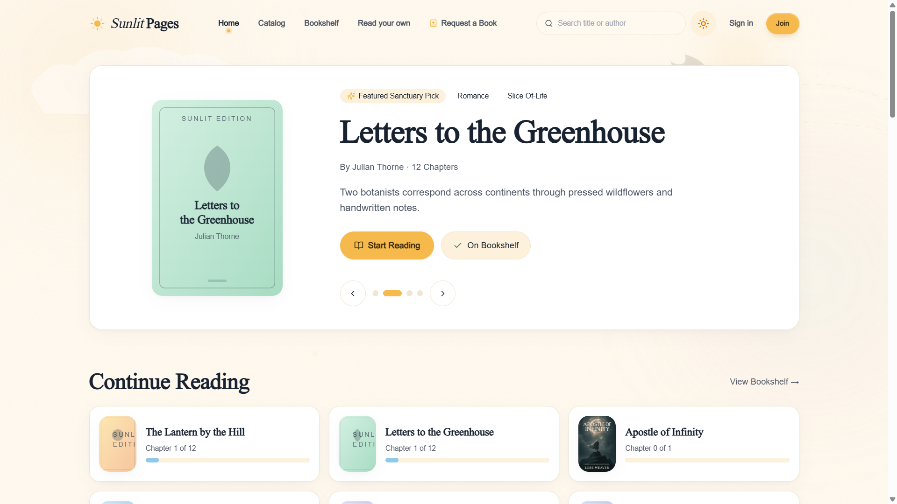
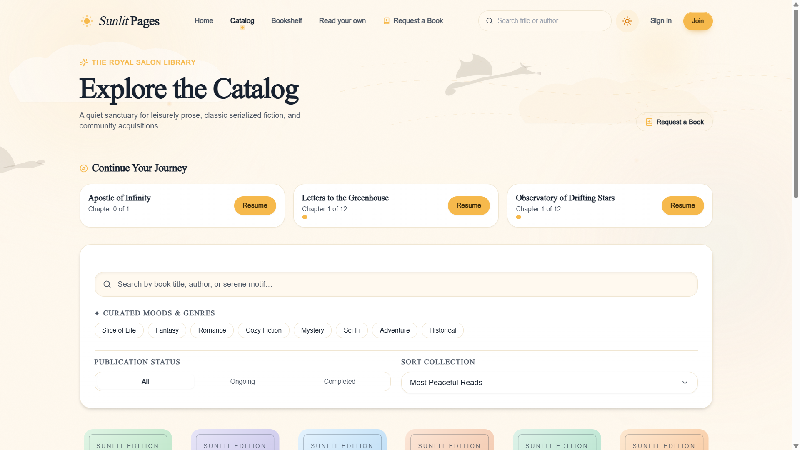
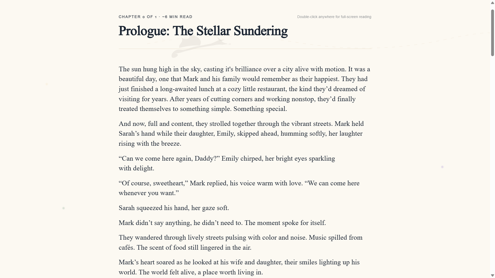
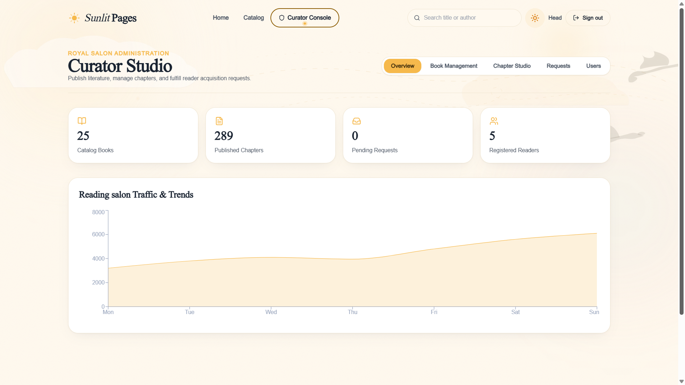

<div align="center">

# ☀️ Sunlit Pages

**A quiet reading room for web fiction, personal documents, and deep distraction-free reading.**

[](https://nextjs.org/)
[](https://www.typescriptlang.org/)
[](https://tailwindcss.com/)
[](https://vitest.dev/)
[](https://playwright.dev/)
[](#accessibility--contrast)

[Explore Catalog](#-catalog--discovery) • [Reader Features](#-immersive-reader) • [Personal Library](#-read-your-own) • [Curator Studio](#-curator--admin-studio) • [Getting Started](#-getting-started)

<br/>

<!-- SCREENSHOT: Main Landing / Hero Preview -->
<a href="#screenshots">
  
</a>

</div>

---

## 📖 Overview

**Sunlit Pages** is crafted for readers who seek peace, focus, and warmth. Built from the ground up around typography, soft geometry, and serene micro-interactions, it provides a quiet sanctuary away from sensory overload.

Browse curated serialized stories, read your own EPUBs or PDFs locally in your browser, listen to instrumental soundscapes, leave thoughtful reflections and comments, or manage the library through a curator studio.

---

## ✨ Features at a Glance

### 🕯️ Immersive Reader
- **5 Calibrated Themes:** Day (`Sunny Morning`), Sepia (`Warm Parchment`), Paper (`Soft Cotton`), Night (`Calm Twilight`), and True-Dark (`OLED Sanctuary`).
- **5 Typography Presets:** Hand-picked typefaces optimized for long-form comfort:
  - *Lora* (Balanced literary serif)
  - *DM Sans* (Clean geometric sans-serif)
  - *Merriweather* (Sturdy editorial modern serif)
  - *Atkinson Hyperlegible* (Braille Institute low-vision accessibility font)
  - *JetBrains Mono* (Distraction-free technical monospace)
- **Fluid Layout Controls:** Granular font size (14–30 px), line height, paragraph spacing, font weight, column width, and text alignment.
- **Distraction-Free Mode:** Hides site navigation, progress chrome, and page clutter with one click or double-click. Exit instantly with `Esc`.
- **Keyboard Shortcuts:**
  - `←` / `→`: Navigate between preceding and subsequent chapters.
  - `Esc`: Close the drawer or toggle fullscreen reading mode.

### 🐉 Genre-Aware Ambient Animations
- **10 Subtle Storybook Presets:** Calming silhouettes automatically match book genres and float gently in margins without obscuring text:
  - **Fantasy / Magic:** Mythical gliding dragon with ember wisp & floating firefly motes.
  - **Romance:** Paired gliding songbirds and drifting pastel flower petals.
  - **Mystery / Thriller:** Silent night owl gliding with low breeze streamline.
  - **Sci-Fi / Space:** Minimalist paper-voyager vessel traversing starlight.
  - **Slice of Life / Cozy:** Gentle swaying botanical sprig and autumn leaves.
  - **Horror / Gothic:** Distant gliding raven with soft crescent moon and horizon mist.
  - **Poetry / Philosophy:** Origami crane soaring across violet breeze currents.
  - **Children / Fables:** Soaring noble griffin with drifting quill feathers and soft clouds.
  - **Historical / Adventure:** Mountain horizon ridge with soaring falcon.
  - **Neutral / Default:** Tranquil songbird with subtle golden sunlight motes.
- **Strict Viewport Isolation:** Portaled directly to `document.body` to eliminate scroll jank and keep animations active in fullscreen mode.
- **Adjustable Intensity:** Toggle between `ambient`, `subtle`, or `off` at any time.

### 🎵 Ambient Instrumental Music & Soundscapes
- **4 Natural Audio Environments:** High-fidelity looping audio:
  - 🌧️ *Forest Rain* (Gentle raindrops through forest trees)
  - ⛈️ *Heavy Rain* (Rhythmic downpour on windowpanes)
  - 🪵 *Warm Hearth* (Comforting crackling fireside)
  - 🍃 *Gentle Breeze* (Soft mountain wind through the valley)
- **4 Curated Instrumental Soundtracks:** Creative Commons CC-BY instrumental orchestral music by Scott Buckley:
  - *Happy & Uplifting:* "Filaments" (Soothing piano and warm strings)
  - *Epic & Adventure:* "Goliath" (Dynamic orchestral cinematic percussion)
  - *Sad & Melancholy:* "Solace" (Introspective piano and cello)
  - *Mystery & Suspense:* "Dark Places" (Tense atmospheric orchestra)
- **Custom YouTube Integration:** Paste any YouTube track or playlist link to listen right inside the reading room with unified volume slider and play/pause controls.

### 📚 Read Your Own Documents
- **Private & Local-First:** Your documents never leave your computer. Everything is parsed and persisted securely in your browser's IndexedDB using Dexie.js.
- **Supported Formats:**
  - **EPUB:** Full chapter navigation and font formatting via `epub.js`.
  - **PDF:** Heuristic text extraction reflowed into readable paragraphs with font-size controls, plus an instant "Original PDF" canvas viewer.
  - **Plain Text & Markdown:** Retains headings, paragraph structure, and bulleted lists.
  - **Paste Text:** Instant reading sandbox for copied articles or chapters.
- **Safety & Validation:** Maximum 25 MB per EPUB/PDF, 2 MB / 1,000,000 characters for plain text. Password-protected and corrupted files show clean, friendly error explanations.

### 💬 Community Engagement & Social Discussions
- **Book & Chapter Comments:** Leave thoughts and discussions on any book or chapter with anti-spoiler considerations.
- **Likes & Dislikes:** Interactive reaction counters on chapters, comments, and book reviews.
- **Registered Reader Safeguards:** Only registered, non-banned users can participate in discussions, write reviews, or submit reactions.
- **Concurrency & Spam Resilience:**
  - Rate limiting: 1 comment per 5s cooldown, max 5 per minute per user, IP flood protection.
  - Atomic in-memory serialization queue with debounced disk snapshots (120ms) and atomic file renames.

### 👑 Curator & Admin Studio
- **Catalog Management:** Create, edit, and organize books with procedural SVG or image covers.
- **Chapter Authoring:** Drag-and-drop chapter reordering with rich TipTap WYSIWYG editing.
- **Catalog Genre Administration:** Add, rename, and remove genres directly within the catalog filter controls.
- **Reader Activity & Moderation:** View member profiles, track review history with links to reviewed titles, ban/unban abusive accounts, or remove spam reviews.
- **Book Proposal Salon:** Review reader proposals submitted through the "Request a Book" modal with one-click status transitions (Pending, Seen, Fulfilled, Rejected).

---

## 🖼️ Screenshots

<div align="center">

### Catalog Salon & Multi-Facet Filtering
<!-- SCREENSHOT: Catalog Page -->


<br/><br/>

### Immersive Reader with Atmosphere & Typography Controls
<!-- SCREENSHOT: Reader View -->


<br/><br/>

### Curator Studio & Reader Reflections
<!-- SCREENSHOT: Admin Studio -->


</div>

---

## 🛠️ Tech Stack & Architecture

| Layer | Technologies |
|---|---|
| **Framework** | [Next.js 14](https://nextjs.org/) (App Router, Server Actions, Route Handlers, Streaming) |
| **Language** | [TypeScript 5.6](https://www.typescriptlang.org/) (Strict type-checking, zero implicit `any`) |
| **Styling** | [Tailwind CSS 3.4](https://tailwindcss.com/), CSS Custom Properties, View Transitions API |
| **Animation** | [Framer Motion 11](https://www.framer.com/motion/), Hardware-accelerated Portals |
| **Client Storage** | [Dexie.js](https://dexie.org/) (IndexedDB wrapper for local documents & reading history) |
| **State Management** | [Zustand 4](https://github.com/pmndrs/zustand) (Reader settings, auth cache, bookshelf sync) |
| **Data Fetching** | [TanStack React Query 5](https://tanstack.com/query) (Automatic cache invalidation & optimistic UI) |
| **Document Parsing** | [epub.js](https://github.com/futurepress/epub.js/), [pdfjs-dist](https://mozilla.github.io/pdf.js/) |
| **Rich Text Editor** | [TipTap 2](https://tiptap.dev/) + StarterKit |
| **Security & Auth** | `scrypt-kdf`, Edge-safe HMAC-SHA256 signed session cookies, CSRF same-origin guards |
| **Testing** | [Vitest 2.1](https://vitest.dev/), Testing Library, [Playwright 1.47](https://playwright.dev/) |

---

## 🚀 Getting Started

### Prerequisites
- **Node.js**: `v20.0.0` or higher
- **npm**: `v10.0.0` or higher

### 1. Installation

```bash
git clone https://github.com/reetiksil/sunlit-pages.git
cd sunlit-pages
npm install
```

### 2. Environment Configuration

Copy the example environment file:

```bash
cp .env.example .env.local
```

Configure your environment variables in `.env.local`:

| Variable | Required | Description |
|---|---|---|
| `AUTH_SECRET` | **Production** | 32+ character random secret used to sign session cookies. Generate with `openssl rand -base64 48`. A fallback exists for development. |
| `ADMIN_EMAILS` | No | Comma-separated list of emails granted the **admin** role upon registration. |
| `DATA_DIR` | No | Path to server data storage for catalog, users, and engagement. Default: `./.data` |
| `ADMIN_EMAIL` | Script only | Admin email for the `npm run seed:admin` script. |
| `ADMIN_PASSWORD`| Script only | Admin password for the `npm run seed:admin` script. |

### 3. Run the Development Server

```bash
npm run dev
```

Open [http://localhost:3000](http://localhost:3000) in your browser.

### 4. Create an Admin Account

You can initialize an admin account in either of two ways:

**Option A — Automated Seed Script:**
```bash
ADMIN_EMAIL=curator@sunlitpages.local ADMIN_PASSWORD="your-secure-password" npm run seed:admin
```

**Option B — Environment Configuration:**
Add your email to `ADMIN_EMAILS` in `.env.local`:
```env
ADMIN_EMAILS=curator@sunlitpages.local
```
Then register normally through the `/register` page. The server automatically assigns the admin role upon creation.

---

## 🌐 Production Deployment Guide

Sunlit Pages is built with standard Next.js 14 App Router and can be deployed anywhere Node.js runs: Vercel, Railway, Render, Fly.io, AWS, or your own VPS.

### Deploying on Vercel (Serverless)

1. **Import Repository**:
   - In your [Vercel Dashboard](https://vercel.com/dashboard), click **"Add New Project"** and select your `sunlit-pages` repository.
   - Framework preset: **Next.js** (detected automatically).

2. **Configure Environment Variables** (Project Settings → Environment Variables):
   | Variable | Value | Notes |
   |---|---|---|
   | `AUTH_SECRET` | *(Random 32+ char string)* | Required. Generate with `openssl rand -base64 48`. |
   | `ADMIN_EMAILS` | `your-email@example.com` | Elevates your account to `admin` upon registration. |
   | `RESEND_API_KEY` | `re_123456...` | **Recommended for email delivery**. Get a free key at [resend.com](https://resend.com). |
   | `EMAIL_FROM` | `Sunlit Pages <onboarding@resend.dev>` | Or your verified domain email (e.g. `noreply@yourdomain.com`). |

   *Alternatively, if using Gmail SMTP instead of Resend:*
   | Variable | Value | Notes |
   |---|---|---|
   | `SMTP_HOST` | `smtp.gmail.com` | SMTP host |
   | `SMTP_PORT` | `587` | Standard TLS port |
   | `SMTP_USER` | `youremail@gmail.com` | Your Gmail address |
   | `SMTP_PASS` | `xxxx xxxx xxxx xxxx` | 16-character Google App Password (not your personal password). |
   | `EMAIL_FROM` | `"Sunlit Pages" <youremail@gmail.com>` | Sender header |

3. **Deploy**:
   - Click **Deploy**. Vercel will build and launch your application globally on Edge + Serverless functions.
   - Once deployed, visit `/register` with the email you configured in `ADMIN_EMAILS`. You will receive a 6-digit OTP in your inbox and be granted full Curator Studio privileges!

> [!NOTE]
> **Serverless Storage Behavior**: On serverless platforms (like Vercel and AWS Lambda), the root filesystem is read-only. Sunlit Pages automatically detects serverless environments and writes dynamic runtime files (`otps.json`, `engagement.json`, `users.json`) to `os.tmpdir()` (`/tmp`), preventing `EROFS` crashes. For indefinite multi-year user persistence across cold starts, consider deploying on a persistent container (e.g. Railway, Render, or Docker with a mounted volume).

### Deploying with Docker / VPS / Railway / Render

For permanent disk persistence across reboots without an external database:
1. Set `DATA_DIR=/data` in your environment.
2. Mount a persistent disk volume to `/data` in your deployment settings.
3. All catalog edits, member registrations, reflections, and chapter comments will persist permanently.

---

## 🔒 Security Architecture

- **Signed Session Tokens:** Uses Edge-safe Web Crypto HMAC-SHA256 tokens stored in `httpOnly`, `SameSite=Lax` cookies with a 7-day expiration.
- **Server-Authoritative Roles:** Roles (`reader`, `admin`) are strictly determined server-side from `ADMIN_EMAILS` and the persisted store. Client payloads attempting to pass `role` are stripped by Zod.
- **Same-Origin CSRF Protection:** All state-changing mutation endpoints (`POST`, `PUT`, `DELETE`) enforce same-origin verification via the `sameOriginOrReject()` guard.
- **Timing Attack Mitigation:** Authentication endpoints employ constant-time comparison (`crypto.timingSafeEqual`) and equalized hashing latency for non-existent users.
- **Granular Rate Limiting:**
  - Authentication (Login/Register): In-memory sliding-window protection.
  - OTP Requests: 60s cooldown per email.
  - Comments: 5s per-user cooldown, max 5/min per user, 25/min per IP.
  - Reactions: 45/min per user, 90/min per IP.
  - Book Proposals: Max 5 submissions per day.

---

## 📡 API Reference

### Authentication (`/api/auth/*`)
| Method | Endpoint | Access | Purpose |
|---|---|---|---|
| `POST` | `/api/auth/register` | Public | Create new reader account |
| `POST` | `/api/auth/login` | Public | Authenticate user & issue signed session cookie |
| `POST` | `/api/auth/logout` | Public | Clear session cookie |
| `GET` | `/api/auth/me` | Public | Retrieve active user profile |
| `POST` | `/api/auth/send-verification-otp` | Public | Send 6-digit registration OTP |
| `POST` | `/api/auth/verify-registration-otp` | Public | Verify registration OTP |
| `POST` | `/api/auth/forgot-password` | Public | Send password reset OTP |
| `POST` | `/api/auth/reset-password` | Public | Reset password using verified OTP |

### Catalog & Reader (`/api/catalog/*`)
| Method | Endpoint | Access | Purpose |
|---|---|---|---|
| `GET` | `/api/catalog/books` | Public | Paginated books search, filter & sort |
| `GET` | `/api/catalog/genres` | Public | List all active genre taxonomy entries |
| `POST` | `/api/catalog/genres` | Admin | Create a new catalog genre |
| `DELETE` | `/api/catalog/genres?slug=...` | Admin | Remove a genre from the catalog |
| `GET` | `/api/catalog/chapters?bookId=...` | Public | List chapters for a given book |
| `POST` | `/api/catalog/books/[id]/view` | Public | Increment reading count (rate-limited by IP) |
| `GET` | `/api/catalog/books/[id]/reviews` | Public | Fetch book reviews enriched with reaction counts |
| `POST` | `/api/catalog/books/[id]/reviews` | Registered | Create or edit a reader reflection |
| `DELETE` | `/api/catalog/books/[id]/reviews?reviewId=...`| Owner/Admin | Remove a review |

### Comments & Reactions (`/api/catalog/*`)
| Method | Endpoint | Access | Purpose |
|---|---|---|---|
| `GET` | `/api/catalog/comments?targetType=...&targetId=...` | Public | Paginated comments with reaction states |
| `POST` | `/api/catalog/comments` | Registered | Post comment (rate limited: 1/5s, max 5/min) |
| `DELETE` | `/api/catalog/comments?commentId=...` | Owner/Admin | Delete a comment |
| `GET` | `/api/catalog/reactions?targetType=...&targetId=...`| Public | Fetch like/dislike reaction summary |
| `POST` | `/api/catalog/reactions` | Registered | Toggle like or dislike |

### Bookshelf & Requests
| Method | Endpoint | Access | Purpose |
|---|---|---|---|
| `GET` | `/api/user/bookshelf` | Registered | Fetch user cloud bookshelf synced with local |
| `POST` | `/api/user/bookshelf` | Registered | Sync local shelf entries to user profile |
| `GET` | `/api/requests` | Registered | List current user's submitted book proposals |
| `POST` | `/api/requests` | Registered | Submit a new book proposal |
| `POST` | `/api/requests/send-otp` | Registered | Send OTP verification for book request submission |

### Curator Studio (`/api/admin/*`)
| Method | Endpoint | Access | Purpose |
|---|---|---|---|
| `GET` | `/api/admin/books` | Admin | List all books including drafts |
| `POST` | `/api/admin/books` | Admin | Create or update a book entry |
| `DELETE` | `/api/admin/books/[id]` | Admin | Permanently delete a book |
| `POST` | `/api/admin/chapters` | Admin | Create or update chapter content (TipTap HTML) |
| `DELETE` | `/api/admin/chapters?id=...` | Admin | Delete a chapter |
| `POST` | `/api/admin/chapters/reorder` | Admin | Reorder chapters by numerical index |
| `GET` | `/api/admin/requests` | Admin | List reader proposals |
| `PATCH`| `/api/admin/requests/[id]` | Admin | Update proposal status |
| `DELETE`| `/api/admin/requests` | Admin | Clear fulfilled or rejected proposals |
| `GET` | `/api/admin/users` | Admin | List registered users with status flags |
| `PATCH`| `/api/admin/users/[id]` | Admin | Ban or unban user |
| `DELETE`| `/api/admin/users/[id]` | Admin | Remove user account |
| `GET` | `/api/admin/users/[id]/activity` | Admin | Fetch user review history & book proposals |

---

## 🧪 Testing & Verification

The project includes unit tests, component tests, and end-to-end tests:

```bash
# Run unit & component test suite (Vitest)
npm test

# Run tests in watch mode
npm run test:watch

# Run TypeScript compiler checks
npm run type-check

# Run Next.js and ESLint code quality checks
npm run lint

# Run Playwright End-to-End tests (requires browser install)
npx playwright install
npm run test:e2e

# Create an optimized production build
npm run build
```

---

## 📂 Project Organization

```
sunlit-pages/
├── .data/                     # Flat-file database storage (git-ignored)
│   ├── catalog.json           # Curated books, chapters, and reviews
│   ├── users.json             # Hashed user records and sessions
│   ├── requests.json          # Reader book proposals
│   └── engagement.json        # Comments, reactions, and threaded discussions
├── docs/                      # Documentation assets & guides
│   └── images/                # Screenshots and UI graphics
├── public/                    # Static assets
│   ├── sounds/                # High-fidelity looping ogg ambient files
│   └── pdf.worker.min.mjs     # Bundled local PDF.js worker
├── scripts/                   # CLI maintenance scripts
│   └── seed-admin.mjs         # Admin account initialization
├── src/
│   ├── app/                   # Next.js App Router (Pages & API endpoints)
│   │   ├── (auth)/            # Login, register, forgot-password
│   │   ├── admin/             # Curator studio and user moderation
│   │   ├── book/[slug]/       # Book detail, reviews, and chapter reader
│   │   ├── bookshelf/         # Personal collection and reading history
│   │   ├── browse/            # Catalog salon with search & genre filters
│   │   ├── read-your-own/     # Local EPUB, PDF, and text reader
│   │   └── api/               # Server route handlers
│   ├── components/
│   │   ├── background/        # Ambient animated sky, sunbeams, clouds, and stars
│   │   ├── book/              # Covers, cards, shelves, and modals
│   │   ├── reader/            # Typography drawer, genre animations, mood audio
│   │   ├── social/            # CommentsSection, ReactionButtons
│   │   └── ui/                # CustomSelect, buttons, navigation
│   ├── config/                # Site metadata and constants
│   ├── lib/                   # Shared client & server utilities
│   │   ├── server/            # Catalog store, user store, rate limiting, guards
│   │   ├── epubTheme.ts       # EPUB stylesheet injector
│   │   ├── pdfText.ts         # PDF paragraph heuristic extraction
│   │   ├── readerStyle.ts     # Reader typography and theme presets
│   │   └── validations.ts     # Zod schemas for forms and files
│   ├── stores/                # Zustand stores (auth, reader, bookshelf)
│   ├── styles/                # Tailwind CSS globals & typography design tokens
│   └── types/                 # Shared TypeScript interfaces
├── DESIGN.md                  # Comprehensive Design System & tokens
└── README.md                  # Main documentation
```

---

## 📄 License

This project is open-source and available under the [MIT License](LICENSE).

Instrumental audio tracks by [Scott Buckley](https://www.scottbuckley.com.au/) are released under the Creative Commons Attribution 4.0 International License (CC-BY 4.0).
